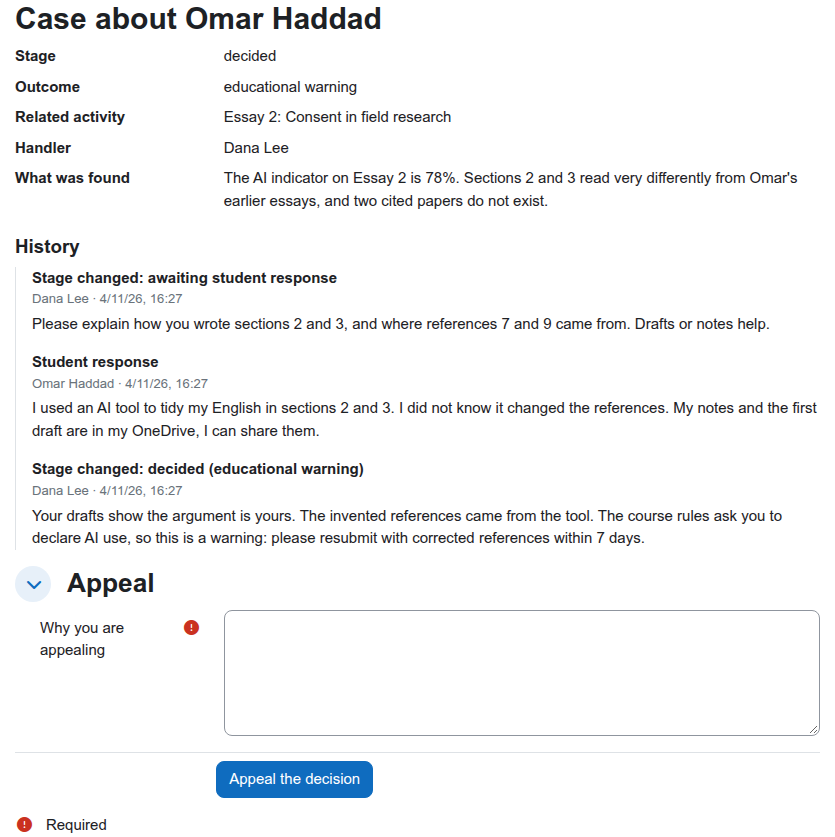
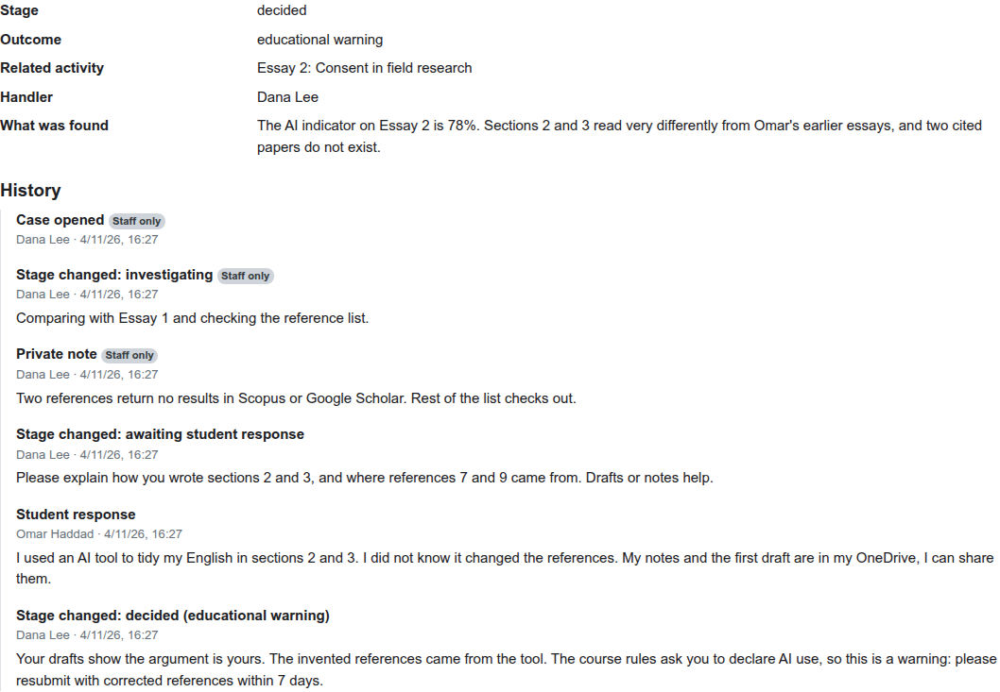

# Academic integrity cases for Moodle (local_integritycase)

[](https://github.com/devlms/moodle-local_integritycase/actions/workflows/ci.yml)
[](https://devlms.github.io/moodle-local_integritycase/)
[](https://devlms.github.io/moodle-local_integritycase/php-coverage/)
[](https://moodledev.io/general/releases)
[](https://www.php.net/supported-versions.php)
[](LICENSE)
[](version.php)
[](https://devlms.com/sponsors/?plugin=local_integritycase)

Track academic misconduct cases inside Moodle: from the first report, through a private investigation and the student's response, to a decision and an appeal. Every step is recorded.

Turnitin, Originality.ai, Copyleaks and the other detectors put a flag next to a submission. Every one of them says a flag is not a finding. What happens next usually lives in email threads and spreadsheets. This plugin is that next step, inside the course, with Moodle's permissions, notifications, logs and privacy tools.



## What it does

| Part | Status |
| --- | --- |
| Open a case on a student in a course, linked to an activity if you like, with a summary and evidence files | Done |
| Stages: reported, investigating, awaiting student response, decided, appealed, closed. Allowed moves are enforced on the server | Done |
| Hidden from the student while staff investigate. Visible from the moment they are asked for their side or told a decision | Done |
| Student response and appeal, from the case page | Done |
| Decisions need an outcome: no case to answer, educational warning, resubmission, mark reduced, referred to a panel | Done |
| Audit trail of every action: who, when, what, and whether the student can see it. Private staff notes never reach the student | Done |
| Notifications: the student on each stage they can see, the handler when the student responds or appeals | Done |
| Moodle log events: case opened, case updated | Done |
| Privacy API: export and delete for students, handlers and note authors, evidence files included | Done |
| Report builder source "Academic integrity cases" for site-wide reports, only for people with `local/integritycase:viewall` | Done |
| Link from the assignment grading page, configurable stages | Planned |



## Install

Needs Moodle 4.5 to 5.3.

1. Download the zip from [Releases](https://github.com/devlms/moodle-local_integritycase/releases) and install it under Site administration, Plugins, Install plugins. Or clone it:

   ```bash
   # Moodle 4.5 and 5.0
   git clone https://github.com/devlms/moodle-local_integritycase.git local/integritycase
   # Moodle 5.1 and later
   git clone https://github.com/devlms/moodle-local_integritycase.git public/local/integritycase
   ```

2. Visit Site administration, Notifications to finish the install.
3. In a course, teachers find "Integrity cases" in the course navigation (More menu).

## Permissions

| Capability | Default roles | Allows |
| --- | --- | --- |
| `local/integritycase:view` | Teacher, non-editing teacher, manager | See every case in the course |
| `local/integritycase:manage` | Teacher, manager | Open, move, decide, add private notes and evidence |
| `local/integritycase:respond` | Student | See own cases once visible, respond, appeal |
| `local/integritycase:viewall` | Manager (site) | Build site-wide reports on cases |

## Privacy

A student's data request covers whole cases about them, staff notes and evidence included. A staff member's request covers their own actions; deleting it keeps the case for the record and removes their name. Notifications go through Moodle's message API.

## Tests

PHPUnit covers the workflow rules, every action and its permission checks, the privacy provider and the report source. A Behat scenario walks a case from report to appeal as teacher and student. CI runs on Moodle 4.5 to 5.3 with PostgreSQL and MariaDB: [reports](https://devlms.github.io/moodle-local_integritycase/).

## Who made it

[DevLMS](https://devlms.com) builds custom Moodle plugins. Need something like this changed for your institution, or a different plugin? [Get a quote](https://devlms.com/#quote).

## Sponsors

<!-- sponsors:start -->
No sponsors yet. [Sponsor this plugin](https://devlms.com/sponsors/?plugin=local_integritycase): your name or logo, with a link to your site, goes here and on [devlms.com/sponsors](https://devlms.com/sponsors/).
<!-- sponsors:end -->

## License

GNU GPL v3 or later.
